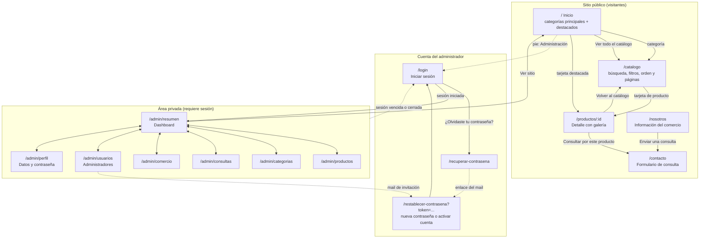

# Diagrama de navegación

Las rutas del frontend están en `frontend/src/App.tsx`. El encabezado (Inicio,
Catálogo, Nosotros, Contacto) y el pie de página están en todas las pantallas
públicas; el enlace **Administración** del pie lleva al login o, con la sesión
iniciada, al panel.

## Pantallas

| Ruta | Acceso | Qué se hace |
| --- | --- | --- |
| `/` | Público | Categorías principales con cantidad y precio desde, y productos destacados (o los más nuevos) |
| `/catalogo` | Público | Catálogo paginado con búsqueda, filtro por categoría (`?categoria=<id>`) y disponibilidad, y orden |
| `/productos/:id` | Público | Detalle del producto con todas sus imágenes y acceso a consultar |
| `/nosotros` | Público | Descripción, dirección, teléfono, horarios y redes del comercio |
| `/contacto` | Público | Formulario de consulta y datos de contacto |
| `/login` | Sin sesión | Ingreso de administradores (con sesión redirige al panel). No hay registro público |
| `/recuperar-contrasena`, `/restablecer-contrasena` | Público | Pedir el enlace de recuperación y elegir una contraseña nueva; con `&invitacion=1`, activar una cuenta creada desde el panel |
| `/admin` | Con sesión | Redirige a `/admin/resumen` |
| `/admin/resumen` | Con sesión | Métricas del catálogo y de las consultas |
| `/admin/productos` | Con sesión | ABM de productos, publicar/ocultar, destacar e imágenes |
| `/admin/categorias` | Con sesión | ABM de categorías |
| `/admin/consultas` | Con sesión | Ver, cambiar de estado y eliminar consultas |
| `/admin/comercio` | Con sesión | Editar la información institucional |
| `/admin/usuarios` | Con sesión | Listar, invitar y eliminar administradores |
| `/admin/perfil` | Con sesión | Modificar datos personales y contraseña |

Sin sesión, las rutas privadas redirigen a `/login`. Si el backend rechaza el
token mientras se usa el panel (venció, se cambió la contraseña o se eliminó la
cuenta), la sesión se cierra y el login explica el motivo. Cualquier ruta
desconocida redirige al inicio.
