# Diagrama de navegación

Las rutas del frontend están en `frontend/src/App.tsx`. El encabezado (Inicio,
Catálogo, Nosotros, Contacto) y el pie de página están en todas las pantallas
públicas; el enlace **Administración** del pie lleva al login o, con la sesión
iniciada, al panel.

```mermaid
flowchart TD
    subgraph Publico["Sitio público (visitantes)"]
        Inicio["/ Inicio<br/>categorías, promociones, destacados y colecciones"]
        Catalogo["/catalogo<br/>búsqueda, panel de filtros, chips, orden y páginas"]
        Detalle["/productos/:id<br/>Detalle con galería y relacionados"]
        Coleccion["/colecciones/:id<br/>Productos de una colección"]
        Nosotros["/nosotros<br/>Información del comercio"]
        Contacto["/contacto<br/>Formulario de consulta"]
        NoExiste["* Página no encontrada"]
    end

    subgraph Cuenta["Cuenta del administrador"]
        Login["/login<br/>Iniciar sesión"]
        Recuperar["/recuperar-contrasena"]
        Restablecer["/restablecer-contrasena?token=...<br/>nueva contraseña o activar cuenta"]
    end

    subgraph Panel["Área privada (requiere sesión)"]
        Resumen["/admin/resumen<br/>Dashboard"]
        Productos["/admin/productos"]
        Categorias["/admin/categorias"]
        Colecciones["/admin/colecciones"]
        Promociones["/admin/promociones"]
        Consultas["/admin/consultas"]
        Comercio["/admin/comercio"]
        Usuarios["/admin/usuarios<br/>Administradores"]
        Perfil["/admin/perfil<br/>Datos y contraseña"]
    end

    Inicio -->|categoría| Catalogo
    Inicio -->|Ver todo el catálogo| Catalogo
    Inicio -->|tarjeta destacada| Detalle
    Inicio -->|promoción| Catalogo
    Inicio -->|promoción con colección| Coleccion
    Detalle -->|etiqueta de la promoción| Coleccion
    Inicio -->|Ver la colección| Coleccion
    Coleccion -->|tarjeta de producto| Detalle
    Coleccion -->|Volver al inicio| Inicio
    Catalogo -->|tarjeta de producto| Detalle
    Catalogo -->|sin resultados: Pedir un producto| Contacto
    Detalle -->|Volver al catálogo| Catalogo
    Detalle -->|relacionado: de su colección o su categoría| Detalle
    Detalle -->|Consultar / Avisame cuando entre| Contacto
    NoExiste --> Catalogo
    Nosotros -->|Enviar una consulta| Contacto

    Inicio -.->|pie: Administración| Login
    Login -->|¿Olvidaste tu contraseña?| Recuperar
    Recuperar -.->|enlace del mail| Restablecer
    Usuarios -.->|mail de invitación| Restablecer
    Restablecer --> Login

    Login -->|sesión iniciada| Resumen
    Resumen <--> Productos
    Resumen <--> Categorias
    Resumen <--> Colecciones
    Resumen <--> Promociones
    Resumen <--> Consultas
    Resumen <--> Comercio
    Resumen <--> Usuarios
    Resumen <--> Perfil
    Resumen -->|Ver sitio| Inicio
    Panel -.->|sesión vencida o cerrada| Login
```

## Pantallas

| Ruta | Acceso | Qué se hace |
| --- | --- | --- |
| `/` | Público | Categorías principales con cantidad y precio desde, promociones vigentes, productos destacados (o los más nuevos) y las colecciones encendidas con sus primeros cuatro productos |
| `/catalogo` | Público | Catálogo paginado con búsqueda, orden y un panel lateral de filtros (una o varias categorías, rango de precio, con stock, ofertas). Los filtros aplicados se ven como chips y viven en la URL: `?q=`, `categoria=<id>,<id>`, `desde=`, `hasta=`, `stock=1`, `ofertas=1`, `orden=`, `pagina=` |
| `/productos/:id` | Público | Detalle del producto con todas sus imágenes, descuento (si viene de una promoción, la nombra y lleva a su colección), aviso de pocas unidades, acceso a consultar (o a pedir aviso si no hay stock) y otros productos de su colección o, si no está en ninguna, de su categoría |
| `/colecciones/:id` | Público | Título, descripción y productos publicados de una colección, en el orden elegido en el panel |
| `/nosotros` | Público | Descripción, dirección, teléfono, horarios y redes del comercio |
| `/contacto` | Público | Formulario de consulta y datos de contacto. Con `?producto=<id>` muestra el producto y completa el asunto; con `&aviso=1`, pide que avisen cuando vuelva a haber stock. `?asunto=` completa el asunto |
| `/login` | Sin sesión | Ingreso de administradores (con sesión redirige al panel). No hay registro público |
| `/recuperar-contrasena`, `/restablecer-contrasena` | Público | Pedir el enlace de recuperación y elegir una contraseña nueva; con `&invitacion=1`, activar una cuenta creada desde el panel |
| `/admin` | Con sesión | Redirige a `/admin/resumen` |
| `/admin/resumen` | Con sesión | Visitas de los últimos 30 días (total, comparación con los 30 anteriores, por día y productos más vistos), productos publicados y sin stock, y consultas por estado |
| `/admin/productos` | Con sesión | ABM de productos, publicar/ocultar, destacar, descuento e imágenes |
| `/admin/categorias` | Con sesión | ABM de categorías |
| `/admin/colecciones` | Con sesión | ABM de colecciones: título, descripción, elegir y ordenar productos, encender/apagar |
| `/admin/promociones` | Con sesión | ABM de promociones: a dónde llevan (ofertas, una categoría o una colección), descuento para la colección, encender/apagar y fechas de vigencia |
| `/admin/consultas` | Con sesión | Ver, cambiar de estado y eliminar consultas |
| `/admin/comercio` | Con sesión | Editar la información institucional |
| `/admin/usuarios` | Con sesión | Listar, invitar y eliminar administradores |
| `/admin/perfil` | Con sesión | Modificar datos personales y contraseña |

Sin sesión, las rutas privadas redirigen a `/login`. Si el backend rechaza el
token mientras se usa el panel (venció, se cambió la contraseña o se eliminó la
cuenta), la sesión se cierra y el login explica el motivo. Cualquier ruta
pública desconocida muestra la página "Esta página no existe", con accesos al
catálogo, al contacto y al inicio.
