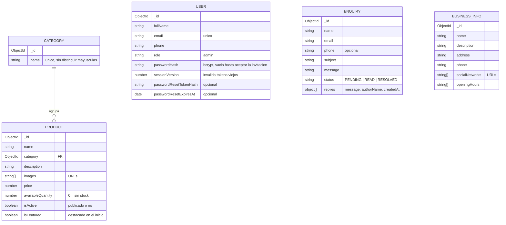

# Modelo de datos

La base es MongoDB. Cada entidad es una colección; todas tienen `createdAt` y
`updatedAt`, y la API expone el `_id` como `id`. Los modelos están en
`backend/src/models`.

## Colecciones

**categories**: las categorías del catálogo. Tienen un índice único sobre
`name` con collation `es` de fuerza 2, así que "Consolas" y "consolas" cuentan
como el mismo nombre.

**products**: las publicaciones. `category` referencia a una categoría que
tiene que existir, y una categoría no se puede borrar mientras tenga productos.
Tienen un índice de Atlas Search (`productSearch`) para la búsqueda por texto,
con los filtros por categoría, precio y estado.

**users**: las cuentas de los administradores (no hay cuentas de clientes). `email` se guarda en minúsculas y tiene índice único.
Las crea otro administrador: la cuenta nace sin `passwordHash` y con un token de
invitación, que se usa igual que uno de recuperación. `sessionVersion` viaja en
cada JWT y aumenta al cambiar o restablecer la contraseña, lo que invalida los
tokens emitidos antes.
La contraseña y el token de recuperación se guardan hasheados y nunca salen en
las respuestas.

**enquiries**: las consultas del formulario de contacto. Arrancan en
`PENDING`; pueden pasar a `READ` o `RESOLVED` y siempre volver a `PENDING`,
pero una `RESOLVED` no pasa a `READ`. Las respuestas enviadas desde el panel
quedan dentro de la consulta en `replies`, con el nombre de quien respondió (no
una referencia, para que se conserve aunque esa cuenta se elimine). Tienen
índices sobre `createdAt` y `status` + `createdAt`, el orden y el filtro de la
bandeja paginada.

**businessinfos**: la información institucional. Hay un único documento, que se
crea o reemplaza con `PUT /api/business-info`.

## Creación de la base

MongoDB crea las colecciones al insertar el primer documento, y los índices
salen de los modelos. El script de creación de la base es
`backend/src/scripts/seed.ts`: `npm run seed` borra los datos, carga los de
demostración (el catálogo está en `backend/src/scripts/seed-catalog.ts`) y crea
el índice de Atlas Search (ver el [README](../README.md#base-de-datos)).
